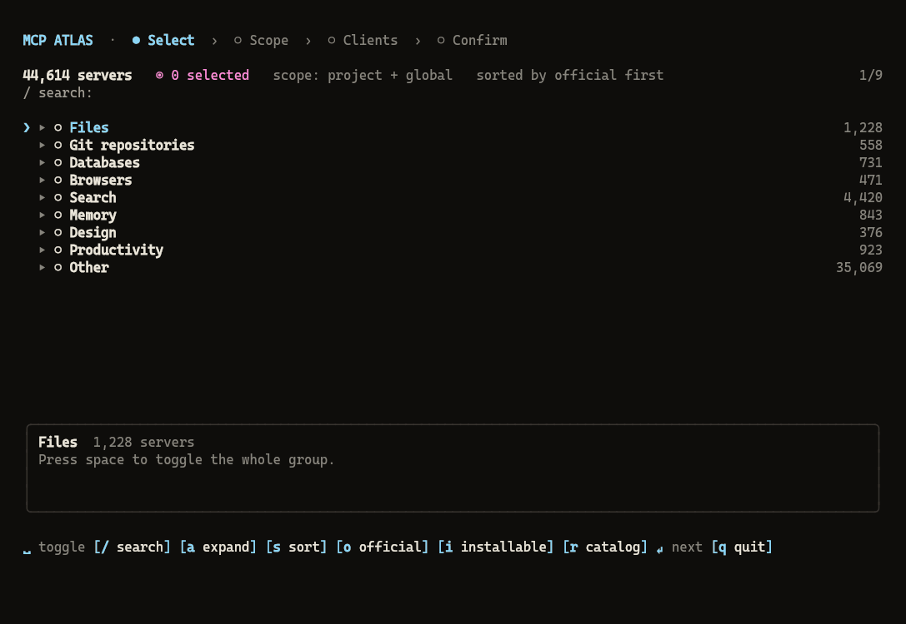

<p align="center"></p>

# mcp-atlas

Browse public **MCP servers** by theme in a collapsible terminal tree or a local web page. Tick several and install them into your MCP clients' config in one go. Installed servers start ticked: untick one to uninstall it.

- **Find**: servers from the official registry, Glama, Smithery and PulseMCP, by theme, plus ★ Recommended and 📦 Packs to install as a block.
- **Check before installing**: read a server's README with `p`, with a [risk check](#audit) of the command it would run.
- **Keep up to date**: installed servers are detected and ticked; untick to uninstall, press `u` to update an outdated pin.
- **Share**: `export` and `import` a selection, or commit an [`mcp-atlas.json`](#a-projects-servers-mcp-atlasjson) so that `mcp-atlas sync` gives every teammate the same servers.
- **Everywhere**: six clients, a terminal tree and a web page, nine languages (en, fr, es, pt, de, it, zh, ja, ko), shell completion, and it works offline.



## Installation

```bash
npm install
npm run build
node dist/cli.js --help
```

Node ≥ 20. The package binary is `mcp-atlas`. `npm run dev` runs it from the sources.

## Usage

```bash
mcp-atlas                                  # interactive: tree → scope → clients → review, then back to the tree
mcp-atlas browse -t databases -q postgres  # tree pre-filtered by theme and text
mcp-atlas browse -a claude-code cursor -g  # options given as flags are not asked
mcp-atlas themes                           # themes and their server counts
mcp-atlas list -t files -n 10              # non-interactive listing (--json available)
mcp-atlas browse -i                        # only servers with a package or a remote to install (also on list)
mcp-atlas agents                           # ids accepted by --agent (★ = detected here)
mcp-atlas install <id> -a claude-code -p   # install without the tree
mcp-atlas uninstall <id> -a cursor -g
mcp-atlas ui                               # the same in your browser
mcp-atlas export > my-servers.json         # installed servers as a bundle (-g / -p for one scope)
mcp-atlas import my-servers.json -a cursor -g
mcp-atlas show <id>                        # a server's README, risks on stderr (--json available)
mcp-atlas outdated                         # pinned servers with a newer catalog version (--json available)
mcp-atlas update                           # rewrite them all (or name some; --dry-run available)
mcp-atlas installed -a cursor              # what each client has (--json available)
mcp-atlas packs                            # packs of servers
mcp-atlas install --pack <id> -a cursor -g # install a whole pack
mcp-atlas sync                             # install what this project's mcp-atlas.json lists and is missing
mcp-atlas doctor                           # check the client config files without changing them
mcp-atlas audit off                        # turn the security audit off for good (on to restore)
mcp-atlas lang fr                          # interface language, remembered (also -l fr on any command)
mcp-atlas mcp                              # MCP server on stdio, for Claude and other agents
mcp-atlas completion bash                  # shell completion script (bash, zsh, fish, powershell)
```

**Shell completion** completes commands, options, server ids, clients and themes, from the cached catalog:

| Shell | Line to add |
|---|---|
| bash (`~/.bashrc`) | `eval "$(mcp-atlas completion bash)"` |
| zsh (`~/.zshrc`) | `eval "$(mcp-atlas completion zsh)"` |
| fish (`~/.config/fish/config.fish`) | `mcp-atlas completion fish \| source` |
| PowerShell (`$PROFILE`) | `mcp-atlas completion powershell \| Out-String \| Invoke-Expression` |

### Keys of the tree

| Key | Action |
|---|---|
| `↑` `↓` `PgUp` `PgDn` | move |
| `→` `←` | open or close a theme |
| `space` | tick a server, or a whole theme |
| `/` | search; `esc` clears it |
| `a` | open or close every theme |
| `s` | sort: official first, or by name |
| `o` | official servers only |
| `i` | only servers with something to install (a package or a remote); installed ones stay |
| `r` | download the full catalog now, then come back to the tree |
| `p` | read the README and the risks |
| `g` | open the repository |
| `u` / `U` | mark an outdated server, or all of them, for update |
| `enter` | next: scope, clients, review |
| `q` | quit |

The mouse works too: wheel to scroll, click to tick, click the hints. `--no-mouse` turns it off.

### Install options

| Flag | Meaning |
|---|---|
| `-a, --agent <ids...>` | clients to write to; `*` is every client of the scope |
| `-g, --global` / `-p, --project` | user profile, or this directory |
| `-y, --yes` | ask nothing: remembered or detected clients, remembered scope |
| `--dry-run` | print the config files, write nothing |
| `--no-audit` | install even when a high risk is found |

What the flags leave open is asked. Without a terminal, `-a` is required. The clients and scope of the last install are remembered in `~/.config/mcp-atlas/config.json`.

`--offline` uses the cached or bundled snapshot and does not contact the network. `--refresh` checks for a newer snapshot now; otherwise a check waits 12 hours. `--catalog <path|url>` reads another snapshot.

## A project's servers: mcp-atlas.json

```json
{ "servers": ["io.github.example/filesystem"], "agents": ["claude-code", "cursor"] }
```

At a repository's root, it lists the servers the project expects. `mcp-atlas sync` installs the missing ones in the project scope, for each listed client (`-a` overrides them). `sync --check` lists them and exits with 1, for CI. `mcp-atlas lock` adds `versions`, the catalog's pin for each server; `sync` then installs exactly those versions and rewrites an entry whose pin drifted.

## Packs

`data/packs.json` holds the bundled packs, and `~/.config/mcp-atlas/packs.json` your own (same id replaces):

```json
[{ "id": "data", "name": "Data", "description": "Databases and files", "servers": ["<id>", "<id>"] }]
```

Each pack is a theme in the tree. `mcp-atlas packs` lists them and `install --pack <id>` installs one.

## Catalog

The snapshot is built from the official registry (`https://registry.modelcontextprotocol.io/v0.1/servers`), then Glama, Smithery and PulseMCP. `npm run crawl` rebuilds it (about an hour). The npm package ships a light snapshot, only the servers with something to install (about 3 MB). The full one (about 14 MB) is downloaded on first use, then checked every 12 hours; `r` in the tree or `--refresh` downloads it now. Nothing in the catalog is executed: not to list tools, and not to read a README. The preview is the declared GitHub README.

Glama needs `GLAMA_API_KEY`, PulseMCP `PULSEMCP_API_KEY` and `PULSEMCP_TENANT_ID`; without them the source is skipped. Locally, copy `.env.example` to `.env` and fill it in: `.env` is git-ignored, and a variable already set in the shell wins over it. On GitHub, `.github/workflows/crawl.yml` crawls every other day and commits the snapshot; add the same names as repository secrets (Settings > Secrets and variables > Actions).

## Audit

The review screen, `install`, `import`, `update` and `sync` check each command before writing it. A high risk leaves the server out unless you keep it on the review screen, or pass `--no-audit`. `mcp-atlas audit off` turns the check off for good. The audit flags an unpinned `npx -y` or `uvx`, a download piped into a shell (`curl | sh`), a path under `~/.ssh` or `~/.aws`, and a remote URL whose host is neither the declared repository nor a known registry.

## Clients

JSON, key `mcpServers`: Claude Code, Claude Desktop (global only), and Cursor.

TOML, table `[mcp_servers.<name>]`: Codex CLI, Codex desktop, and Grok Build. Codex CLI and Codex desktop share the same files.

`mcp-atlas doctor` reads them all and names a file that does not parse, an entry without a command, and a command that is not on the PATH.

## Related projects

The same tree, flags and review for the other kinds of agent extensions:

- [skills-atlas](https://github.com/devohmycode/skills-atlas): Agent Skills (`SKILL.md`), installed through `npx skills add`.
- [plugins-atlas](https://github.com/devohmycode/plugins-atlas): agent plugins from marketplaces (skills, commands, subagents, hooks, MCP servers).

## License

MIT.
